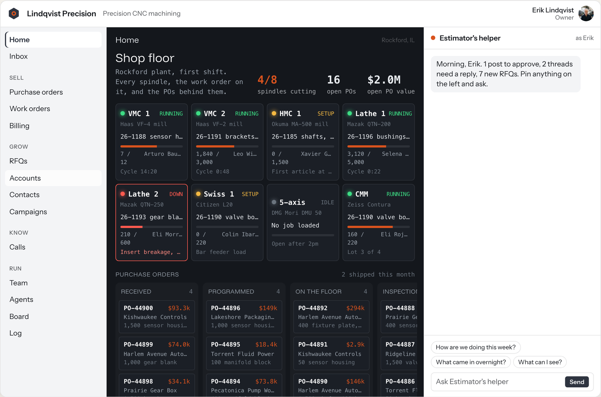
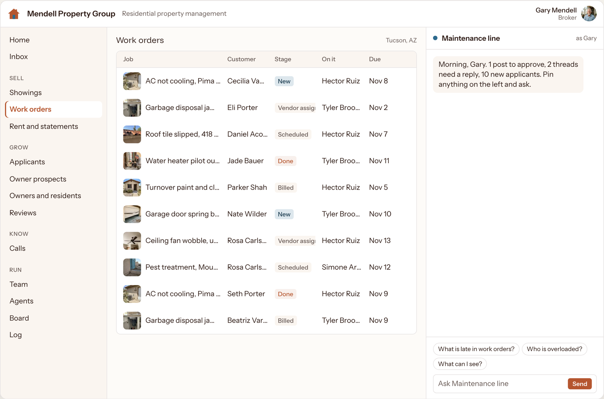
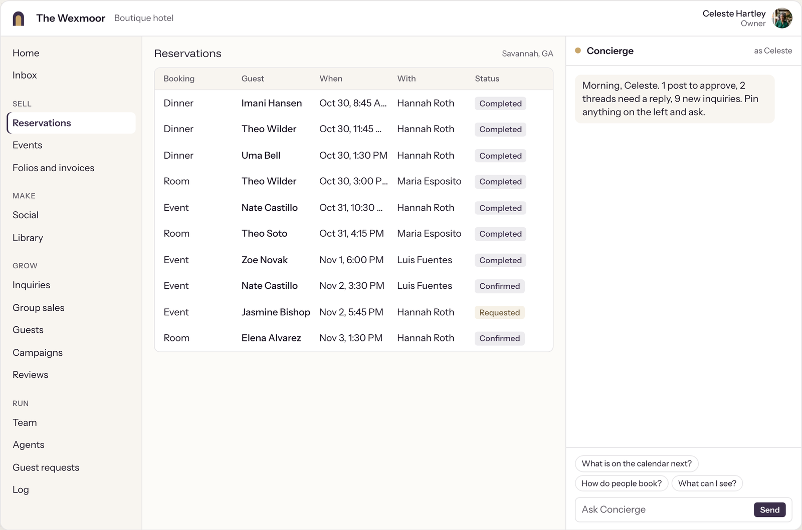
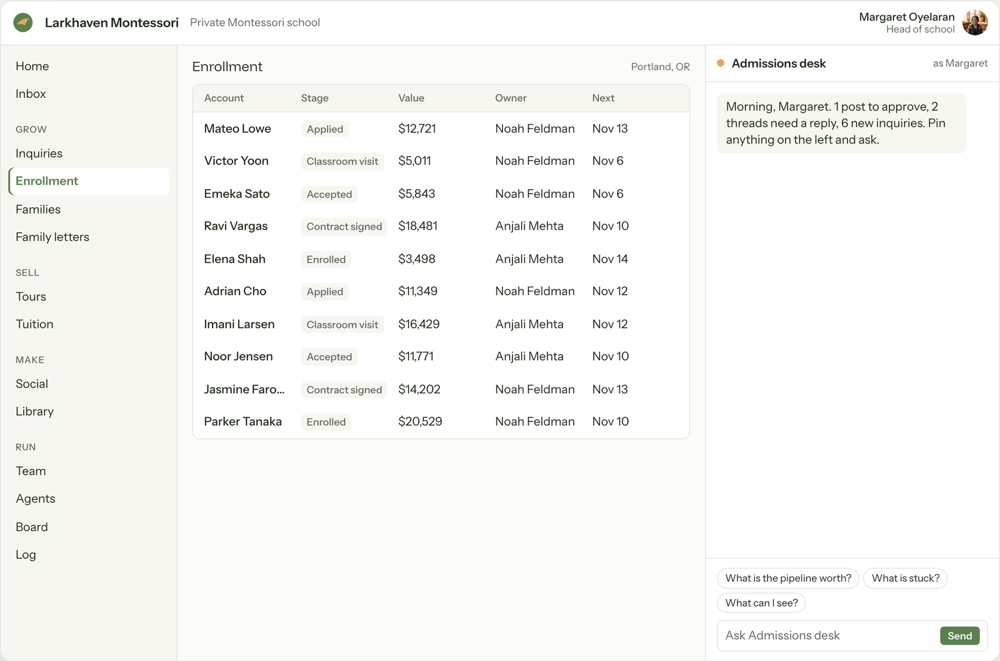
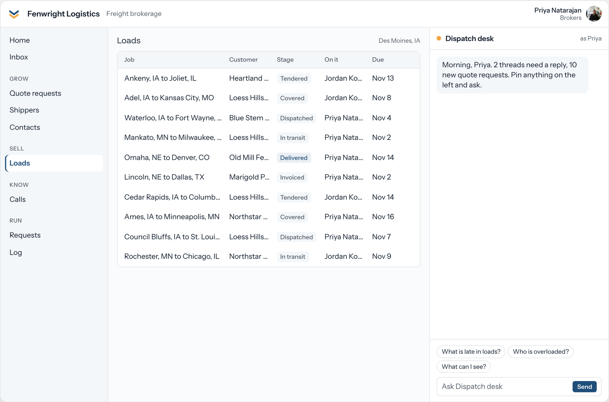
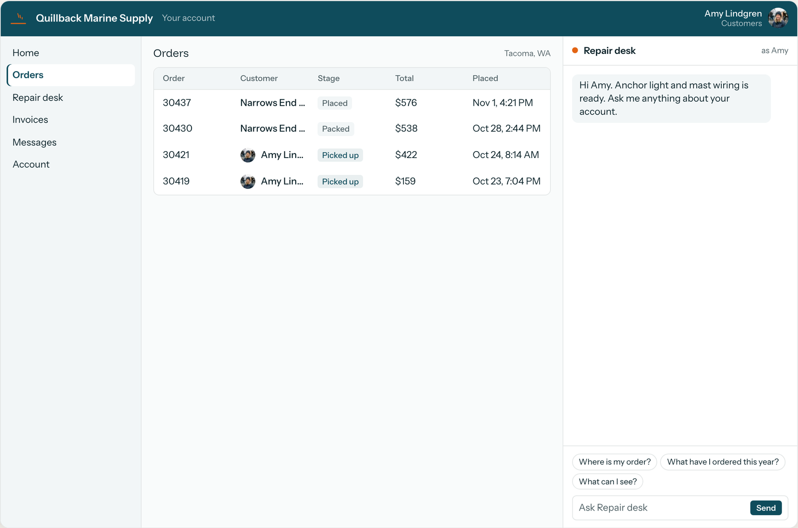
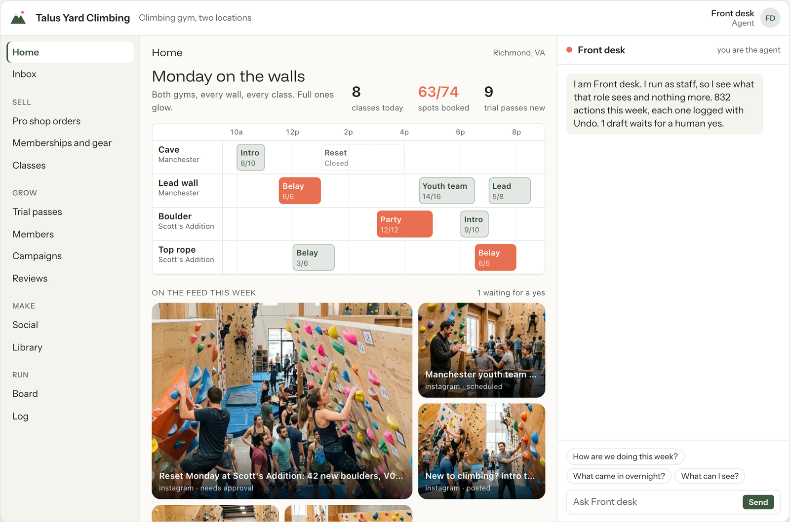
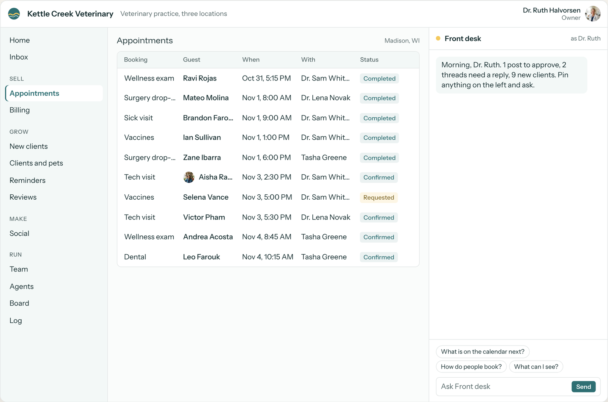

```
 ____           _   ____                     _ _            _    ___ 
|  _ \ ___  ___| |_/ ___|  ___ __ _ _ __ ___(_) |_ _   _  / \  |_ _|
| |_) / _ \/ __| __\___ \ / __/ _` | '__/ __| | __| | | |/ _ \  | | 
|  __/ (_) \__ \ |_ ___) | (_| (_| | | | (__| | |_| |_| / ___ \ | | 
|_|   \___/|___/\__|____/ \___\__,_|_|  \___|_|\__|\__, /_/   \_\___|
                                                    |___/             
```

### Your Everything App.

PostScarcity AI builds one app for your whole business. A customer side, an admin side, one left nav, and an agent in a chat panel on every screen that sees what you see and does the work.

We call it **Yea**. It is not a product you buy. No license, no seat price, no vendor lock. Every business gets its own copy, on its own cloud, with its own models, in its own name from day one.

**Live by day 30. Yours by day 90.**

[See it at postscarcity.ai/yea](https://postscarcity.ai/yea)

---

### What it looks like

Same shell, same components, configured for each business. These are eight of the companies in the live demo. The companies, people and numbers are made up. Almost every module behind them already runs in a real business.

| | |
|---|---|
|  |  |
| **Machine shop, owner.** Every spindle, the work order on it and the POs behind them. | **Property management, broker.** Work orders from photo to billed. |
|  |  |
| **Boutique hotel, owner.** Rooms, dinners and events in one list. | **Private school, head of school.** Enrollment from inquiry to signed. |
|  |  |
| **Freight brokerage, staff.** Staff see what their role allows and nothing more. | **Marine supply, customer.** Customers get their own portal: orders, repairs, invoices. |
|  |  |
| **Climbing gym, as the agent.** The agent is a user with a role, never a superuser. Every write is logged with Undo. | **Vet practice, owner.** Appointments across three locations. |

---

### How it is put together

| | |
|---|---|
| **38 modules** | Grow, Sell, Make, Know and Run. Leads, Pipeline, Outreach, Orders, Bookings, Content, Calls, Insights, Board and the rest. Turn on what the business does, relabel it in their words. |
| **Six user types** | Owner, Admin, Staff, Contractor, Customer, Agent. One permission check in the nav, the routes, every action and every agent tool. |
| **An agent on every screen** | Pin anything on the left and ask. It drafts, files and follows up. Every send, publish, spend and delete waits for a human yes. |
| **Any cloud, any model** | It runs where the business wants it to run. It does not matter which cloud. |
| **Proven first** | Almost every module is a pattern already running in production at a real business. The three that are not yet (Bookings, Documents, Money) say so at the top of their spec. |

---

### Get on Yea

Paste this into any agent:

```
Read https://www.postscarcity.ai/get-on-yea.md and follow the instructions to unlock abundance
```

It runs a six-question interview, shows you your app's left nav, then starts the build. Or [book a call](https://postscarcity.ai/reach-out) and we build it with you.

---

### Sunset

The open source tools we shipped here are sunset. Their best parts now live inside Yea as modules. The repos stay up for reference and get no new work.

| Repo | Was | Lives on in Yea as |
|------|-----|--------------------|
| [cover](https://github.com/postscarcityai/cover) | Site template that personalizes on first run | Site |
| [forge](https://github.com/postscarcityai/forge) | AI image and video generation | Studio, Library |
| [close](https://github.com/postscarcityai/close) | Contract CRM with Google Docs generation | Pipeline, Documents |
| [ascii](https://github.com/postscarcityai/ascii) | Audio-reactive ASCII visualizer | Retired |

---

### Code is liquid

Software is not static anymore. Agents write it from a clear spec, for one business at a time, and rewrite it when something better exists. That is the point. The value is in the orchestration, not the license.

---

*PostScarcity AI. Unlock Abundance.* · [postscarcity.ai](https://postscarcity.ai)
